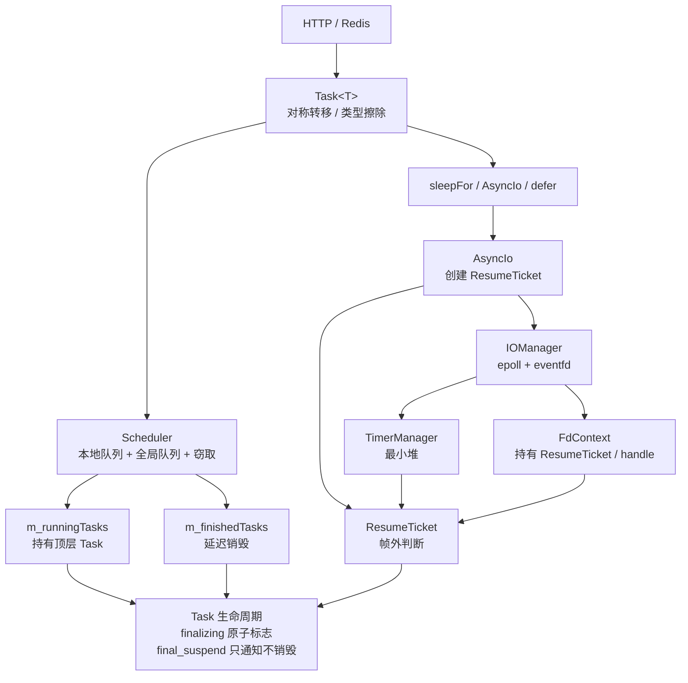
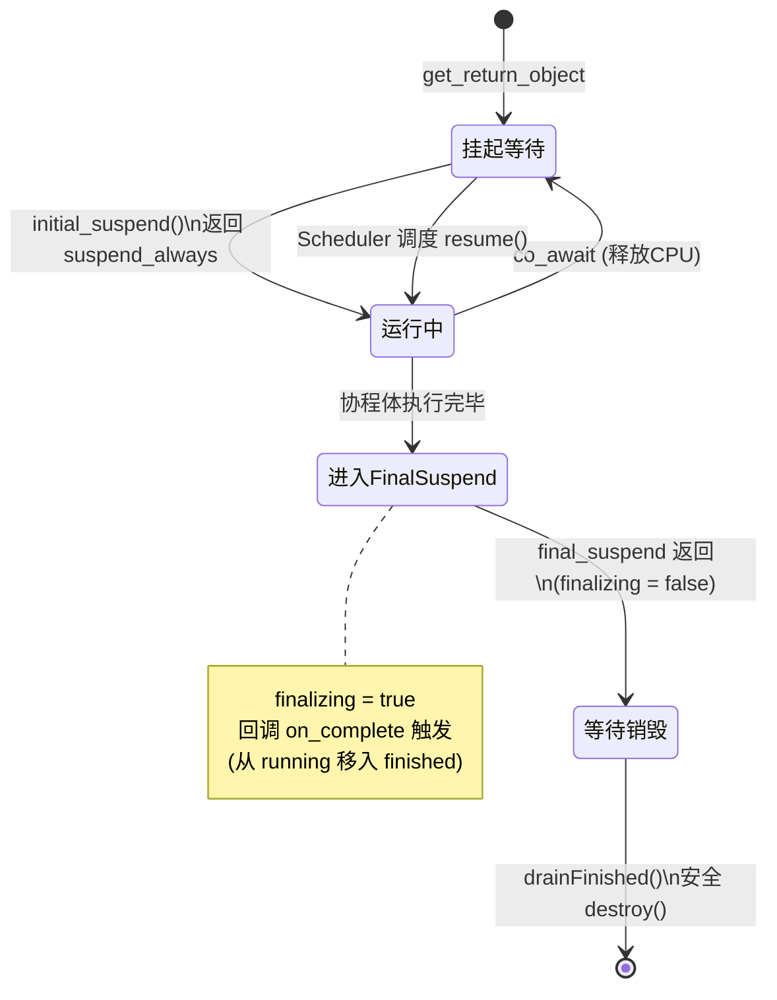
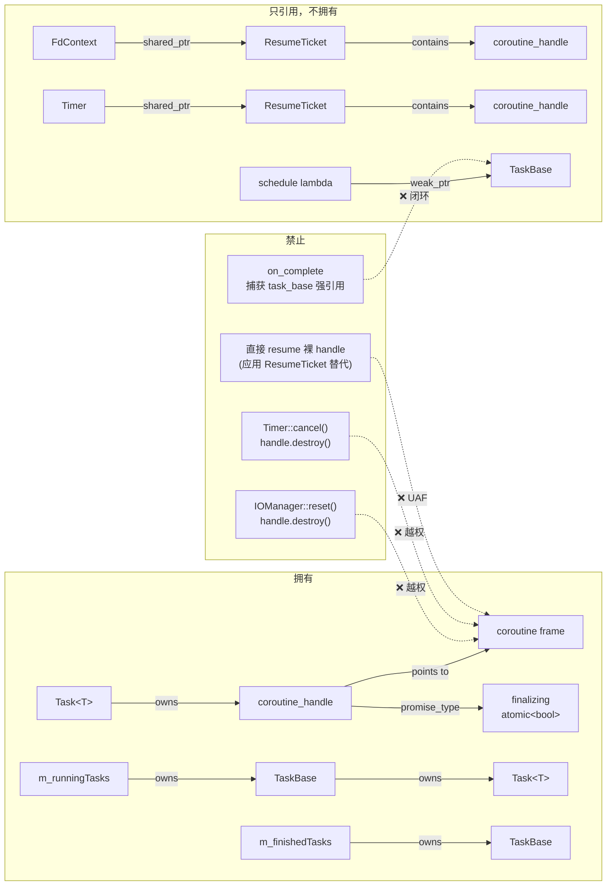
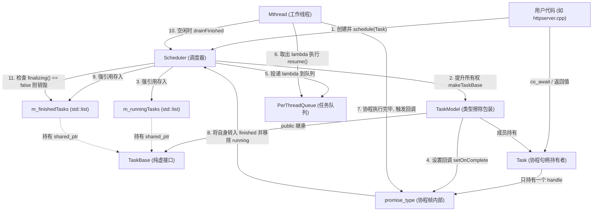

# Blue - C++20 协程服务器框架
[](https://github.com/computer-white/BlueRedis/actions/workflows/ci.yml)

基于 C++20 无栈协程的异步网络框架，支持 epoll 事件驱动、HTTP 客户端/服务端、连接池。
本项目实现了一个支持 `co_await` 的无栈协程类型 `Task<T>`（支持 `T` 与 `void`），专为高并发网络服务设计。不同于常见的教学级单线程协程 Demo，本模块重点解决了**多线程调度下协程帧（Coroutine Frame）的生命周期与悬垂引用问题**。

## ✨ 核心架构设计

### 1. 类型擦除与所有权提升（Type Erasure & Ownership Lift）
`Task<T>` 本身是一个轻量级的移动语义对象。当任务被提交给 `Scheduler` 时，通过 `TaskModel<T>`（继承自 `TaskBase`），将具体的协程句柄提升为 `std::shared_ptr<TaskBase>`。
- **解决的问题**：避免因为用户栈帧销毁，导致协程帧被意外连坐销毁。

### 2. 延迟销毁与安全转移（Deferred Destruction & Safe Handoff）
在 `final_suspend` 阶段，协程通过预先注册的 `on_complete` 回调，将自身的 `shared_ptr` 从 `m_runningTasks`（运行中列表）转移到 `m_finishedTasks`（已完成列表）。
- **设计精妙点**：转移过程严格遵循“先 `push` 到 finished 列表，后 `remove` 从 running 列表”，这一操作顺序保证了在极端多线程竞态下，协程对象的引用计数永远不会瞬间归零，彻底杜绝了并发导致的空悬指针（UAF）。

### 3. `finalizing` 原子免死金牌（Atomic UAF Prevention）
由于 C++20 协程的机制，在进入 `final_suspend` 后，协程依然在执行内部逻辑（例如调用完成回调）。如果此时外部调度器因为引用计数归零而执行 `destroy()`，会发生“摧毁正在执行自身的函数”的致命 UAF。
- **解决方案**：在 `promise_type` 中引入 `std::atomic<bool> finalizing`。进入 `final_suspend` 时置为 `true`，完全退出前置为 `false`。调度器的清理逻辑（`drainFinished`）在销毁协程前必须检查此标志位，实现安全的延迟回收。

## 架构



## 协程生命周期



## 协程所有权关系



### 更加详细的所有权和流程



## 特性

- **C++20 无栈协程** — `Task<T>`、`Scheduler`、`IOManager`，对称转移（Symmetric Transfer）
- **epoll 事件驱动** — 异步 I/O（`co_await Read/Write/Accept`）、定时器（`co_await sleepFor`）
- **HTTP 客户端** — GET/POST、HTTPS、连接池（Keep-Alive 复用）
- **HTTP 服务端** — 基于 llhttp 的请求解析、Servlet 路由
- **配置系统** — YAML / JSON 热加载，支持配置变更回调
- **redis** — 使用c++20协程的redis服务器

## 编译器
```bash
sudo apt install g++-13 gcc-13
```

## 库
```bash
sudo apt install libboost-iostreams-dev libboost-coroutine-dev libboost-context-dev
sudo apt install libssl-dev libyaml-cpp-dev nlohmann-json3-dev
sudo apt install libmysqlclient-dev libhiredis-dev
sudo apt install -y \
    g++-12 \
    cmake \
    libevent-dev \
    libabsl-dev \
    libfmt-dev \
    libgflags-dev \
    libglog-dev \
    libboost-all-dev \
    libssl-dev \
    libhiredis-dev \
    libyaml-cpp-dev \
    ragel
```
```bash
abseil-cpp编译：
cd /path/to/abseil-cpp
rm -rf build && mkdir build && cd build

cmake .. \
  -DCMAKE_POSITION_INDEPENDENT_CODE=ON \
  -DCMAKE_INSTALL_PREFIX=/usr/local \
  -DCMAKE_BUILD_TYPE=Release

make -j$(nproc)
sudo make install
```
```bash
**第三方源码**:`thirdparty/llhttp-release-v9.2.0/` 已 vendor 进仓库,
克隆后无需额外下载。`
```

## 支持命令
<details> <summary><b>点击展开完整命令列表</b></summary>
连接命令
PING, AUTH, SELECT, CLIENT, CONFIG

String 命令
SET, GET, MSET, MGET, APPEND, SETNX, INCR, INCRBY, DEL, EXISTS, STRLEN, TYPE, GETSET

Hash 命令
HSET, HGET, HGETALL, HDEL, HLEN, HEXISTS, HKEYS, HVALS

List 命令
LPUSH, RPUSH, LPOP, RPOP, LRANGE, LLEN, LINSERT, LINDEX, LSET, RPOPLPUSH, LPOPRPUSH

Set 命令
SADD, SMEMBERS, SREM, SISMEMBER, SCARD, SRANDMEMBER, SPOP, SDIFF, SINTER, SUNION, SMOVE

Sorted Set 命令
ZADD, ZRANGE, ZREM, ZSCORE, ZRANK, ZINCRBY, ZCOUNT, ZRANGEBYSCORE, ZREMRANGEBYSCORE, ZINCRBYFLOAT

Server 命令
FLUSHDB, DBSIZE, INFO, SAVE, BGSAVE, LASTSAVE, COMMAND, ECHO, TIME, LOCALTIME, SHUTDOWN, KEYS, EXPIRE, TTL, PEXPIRE, PTTL, PERSIST, RENAME, RENAMENX, RANDOMKEY

事务命令
MULTI, EXEC, DISCARD, WATCH, UNWATCH

高级功能
SUBSCRIBE, PUBLISH, UNSUBSCRIBE, SLOWLOG, MONITOR, AOFROTATE, REPLICAOF, SLAVEOF
</details>

# 说明

## 协程模型
每个客户端连接对应一个协程
使用 IOManager 调度协程
对称转移减少协程切换开销

## 存储引擎
128 分片：将数据分散到 128 个分片，减少锁竞争

16 个数据库：支持 Redis 多数据库模式

absl::flat_hash_map：高性能哈希表，比 std::unordered_map 快 30%

## 持久化
RDB：定期快照保存

AOF：追加日志，支持 always、everysec、no 三种策略

# 快速开始

## 编译
```bash
git clone https://github.com/computer-white/BlueRedis.git blue
cd blue

mkdir -p build && cd build
cmake ..
make -j$(nproc)
```

**产物位置**:

- 可执行文件:`bin/`
- 库文件:`lib/libblue.so` / `lib/libblue.a`

### 只构建库,不构建测试

```bash
cmake ..
```

### 开启 ASAN(推荐开发时使用)

```bash
cmake .. -DENABLE_ASAN=ON
make -j$(nproc)
```

---

## 测试

```bash
cd build
make -j$(nproc)
ctest --output-on-failure
```

### 只跑特定测试

```bash
ctest -R test_url --output-on-failure
./bin/test_task --gtest_filter='TaskBasic.*'
./bin/test_iomanager --gtest_filter='IOFdTest.*'
```

### 用 ASAN 跑全部测试

```bash
cmake .. -DENABLE_ASAN=ON
make -j$(nproc)
ctest --output-on-failure
```

---

## ⚠️ 开发注意事项

> 以下是踩过坑之后总结的经验。**写协程代码前请读一遍**,能省几小时调试。

---

### 1. 协程 lambda 捕获栈变量 → 悬空引用

C++20 协程帧**只保存 lambda 对象的 `this` 指针**,不保存 lambda 对象本身。如果 lambda 是临时对象且协程挂起,捕获的变量会在挂起点之后悬空。

**禁止**:

```cpp
// ❌ 危险:协程帧只保存 lambda 的 this,挂起后 lambda 对象可能已析构
iom.schedule([x, y]() -> blue::Task<void> {
    co_await sleepForMs(10);
    use(x, y);   // 💥 可能访问已析构的 lambda 对象
}());
```

**正确做法**:把数据通过**函数参数**传入(参数会被拷贝到协程帧,生命周期与协程一致):

```cpp
// ✅ 安全
// 同时注意协程参数不能使用&引用，一般我会使用值传递加上std::move()来避免不必要的拷贝
blue::Task<void> do_thing(X x, Y y) {
    co_await sleepForMs(10);
    use(x, y);
    co_return;
}
iom.schedule(do_thing(x, y));
```

**判断标准**:只要是"会挂起"的协程,就**不能用 lambda 捕获**。无捕获的 lambda 或普通函数才安全。


### 2. `Task` 是懒启动的

因为 `initial_suspend` 返回 `suspend_always`,创建后协程体**不会自动执行**:

```cpp
auto t = add_async(1, 2);   // ← 此时协程体一行都没跑
t.resume();                 // ← 需要显式驱动
t.get();                    // ← 拿结果 / 重抛异常
```

**这带来的好处**:可以精确控制何时启动,避免意外的同步执行。

**这带来的注意点**:忘了 `resume` 会导致协程永远不执行;

## 快速开始

```cpp
#include "blue/io_manager.h"
#include "blue/await.h"

blue::Task<void> hello()
{
    co_await blue::sleepForMs(100);
    std::cout << "Hello from coroutine" << std::endl;
    co_return;
}

int main()
{
    blue::IOManager iom(4);
    iom.schedule(hello());
    iom.wait_all();
}
```

### 3.协程的完成只能通知外部去清理，但是不能自己清理，所以在final_suspend里面不能调用任何可能删除当前协程帧的操作或回调
```cpp
// 函数内部不能调用或使用可能导致当前即将进行对称转移的协程帧被销毁的操作
// 这个外部回调会包含清理即将使用的协程帧的操作，跟上面的self.reset()本质
// 一样
SubCorroutine final_suspend() noexcept
{
    if (on_complete)
    {
        auto cb = std::move(on_complete);
        on_complete = nullptr;
        cb();
    }
    return SubCorroutine{fa};
}
```

## 启动Redis服务器(保证没有开UBSAN,会与absl冲突)

### 1. Default (Localhost)
```bash
./bin/blueredis-server
# Server started at 127.0.0.1:6666
```

### 2. Custom Host and Port
```bash
./bin/blueredis-server --bind 0.0.0.0 --port 6379
# Or using short options
./bin/blueredis-server -b 0.0.0.0 -p 6379
```

### 3. Show Help
```bash
./bin/blueredis-server --help
```

### 4. Connect with redis-cli
```bash
redis-cli -h 127.0.0.1 -p 6666
127.0.0.1:6666> PING
PONG
```


# 性能测试

## 命令
```bash
    # 基础性能测试
    redis-benchmark -h 127.0.0.1 -p 6666 -a client123 -t set,get -c 100 -n 100000

    # 管道模式测试
    redis-benchmark -h 127.0.0.1 -p 6666 -a client123 -t set,get -P 32 -c 100 -n 1000000 -q
```
# 结果
### Pipe
```bash              
    blue@Plus:~/c_projects/newblue$ redis-benchmark -h 127.0.0.1 -p 6666 -a client123 -c 100 -n 1000000 -t set,get,lpush,lpop,rpush,rpop,sadd,srem -P 8 -q
    WARNING: Could not fetch server CONFIG
    SET: 162548.77 requests per second, p50=4.775 msec                    
    GET: 245941.95 requests per second, p50=3.135 msec                    
    LPUSH: 148257.97 requests per second, p50=4.847 msec                     
    RPUSH: 158052.78 requests per second, p50=4.943 msec                    
    LPOP: 144300.14 requests per second, p50=5.375 msec                    
    RPOP: 132450.33 requests per second, p50=5.415 msec                    
    SADD: 147710.48 requests per second, p50=4.871 msec                    

    blue@Plus:~/c_projects/newblue$ redis-benchmark -h 127.0.0.1 -p 6666 -a client123 -c 100 -n 1000000 -t set,get,lpush,lpop,rpush,rpop,sadd,srem -P 16 -q
    WARNING: Could not fetch server CONFIG
    SET: 195924.77 requests per second, p50=7.951 msec                      
    GET: 235904.70 requests per second, p50=5.127 msec                     
    LPUSH: 192122.97 requests per second, p50=8.127 msec                      
    RPUSH: 166861.34 requests per second, p50=8.031 msec                     
    LPOP: 157257.42 requests per second, p50=8.783 msec                     
    RPOP: 163398.70 requests per second, p50=8.847 msec                      
    SADD: 170183.80 requests per second, p50=8.479 msec                    

    blue@Plus:~/c_projects/newblue$ redis-benchmark -h 127.0.0.1 -p 6666 -a client123 -c 100 -n 1000000 -t set,get,lpush,lpop,rpush,rpop,sadd,srem -P 32 -q
    WARNING: Could not fetch server CONFIG
    SET: 215563.70 requests per second, p50=14.511 msec                     
    GET: 337495.78 requests per second, p50=9.271 msec                     
    LPUSH: 214132.77 requests per second, p50=14.679 msec                     
    RPUSH: 208376.75 requests per second, p50=14.775 msec                     
    LPOP: 197199.77 requests per second, p50=15.855 msec                     
    RPOP: 198570.30 requests per second, p50=15.983 msec                   
    SADD: 211237.84 requests per second, p50=14.951 msec
```
### 非Pipe
```bash
    blue@Plus:~/c_projects/newblue$ redis-benchmark -h 127.0.0.1 -p 6666 -a client123 -c 100 -n 1000000 -t set,get,lpush,rpush,lpop,rpop,sadd,srem -q
    WARNING: Could not fetch server CONFIG
    SET: 69871.44 requests per second, p50=1.343 msec                   
    GET: 80808.08 requests per second, p50=1.079 msec                   
    LPUSH: 66379.02 requests per second, p50=1.367 msec                   
    RPUSH: 69584.58 requests per second, p50=1.327 msec                   
    LPOP: 67015.15 requests per second, p50=1.271 msec                   
    RPOP: 70866.70 requests per second, p50=1.247 msec                    
    SADD: 65828.45 requests per second, p50=1.391 msec
```
# 机器参数
```bash
===== CPU =====
Architecture:                         x86_64
CPU(s):                               16
Model name:                           12th Gen Intel(R) Core(TM) i5-12500H
===== 内存 =====
               total        used        free      shared  buff/cache   available
Mem:           7.6Gi       2.2Gi       2.1Gi       1.0Mi       3.3Gi       5.2Gi
Swap:          2.0Gi       371Mi       1.6Gi
===== 磁盘 =====
Filesystem      Size  Used Avail Use% Mounted on
none            3.9G     0  3.9G   0% /usr/lib/modules/6.6.87.2-microsoft-standard-WSL2
none            3.9G  4.0K  3.9G   1% /mnt/wsl
drivers         909G  474G  435G  53% /usr/lib/wsl/drivers
/dev/sdd       1007G   61G  896G   7% /
none            3.9G  124K  3.9G   1% /mnt/wslg
none            3.9G     0  3.9G   0% /usr/lib/wsl/lib
rootfs          3.8G  2.7M  3.8G   1% /init
none            3.9G  936K  3.8G   1% /run
none            3.9G     0  3.9G   0% /run/lock
none            3.9G  4.0K  3.9G   1% /run/shm
none            3.9G   76K  3.9G   1% /mnt/wslg/versions.txt
none            3.9G   76K  3.9G   1% /mnt/wslg/doc
C:\             909G  474G  435G  53% /mnt/c
snapfuse         51M   51M     0 100% /snap/snapd/27710
snapfuse         51M   51M     0 100% /snap/snapd/27738
snapfuse         67M   67M     0 100% /snap/core24/1643
===== 系统 =====
 Static hostname: Plus
       Icon name: computer-container
         Chassis: container
      Machine ID: 626723b9f60d4c5696cd170f0175d379
         Boot ID: c91285b3aba24b148269ed9103855ec3
  Virtualization: wsl
Operating System: Ubuntu 22.04.5 LTS                    
          Kernel: Linux 6.6.87.2-microsoft-standard-WSL2
    Architecture: x86-64
```
# 关闭服务器
### 1.使用管理员登录进去，输入shutdown
```bash
    blue@Plus:~/c_projects/newblue$ redis-cli -p 6666
    127.0.0.1:6666> auth admin123
    OK
    127.0.0.1:6666> shutdown
    "OK - waiting for clients to disconnect"
    127.0.0.1:6666> exit
```
### 2.直接按ctrl + c
    ctrl + c

# 欢迎提交 Issue 和 Pull Request！

# License
### This project is licensed under the GNU General Public License v3.0 - see the [LICENSE.md](LICENSE.md) file for details.
