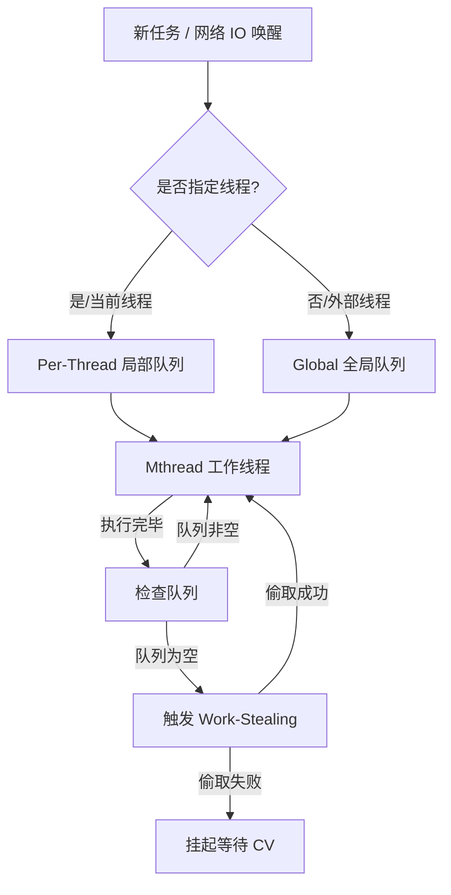

# Scheduler - M:N 任务窃取（Work-Stealing）调度器

本模块实现了一个兼容 C++20 协程的高性能 M:N 调度器，支持数万个协程任务的并发执行，旨在提供类似 Go 语言 GMP 模型的底层调度能力。

## ✨ 核心架构设计

### 1. 混合队列架构（Per-Thread + Global）
- **Per-Thread 局部队列**：每个工作线程维护一个无锁/自旋锁保护的 `std::deque`。新创建的任务优先压入当前线程队列，最大程度利用 CPU 缓存（Cache Locality），避免全局锁竞争。
- **Global 全局队列**：处理跨线程调度、IO 事件唤醒以及线程池外的任务提交。

### 2. 任务窃取机制（Work-Stealing）
当工作线程的局部队列为空时，它不会立刻休眠，而是通过 `stealTask()` 机制，利用随机算法（防止集中竞争）尝试从其他繁忙线程的队列尾部窃取任务。
- **目的**：实现负载均衡（Load Balancing），确保没有线程处于长时间空闲，而其他线程在排队。

### 3. 状态驱动的底层挂起与唤醒
调度器彻底脱离了 Busy-Waiting（忙等待）。当无任务时，线程通过 `std::condition_variable` 进入低功耗阻塞状态；一旦有新任务注入，通过 `notify_one` 与 `tickle()`（IOManager 中的 epoll 唤醒）机制实现毫秒级的响应恢复。

### 4. 优雅停机与屏障清理（Wait-All & Drain）
- 引入 `m_pending`（待处理任务数）与 `m_running`（正在执行数）双原子计数器。
- `wait_all()` 接口通过条件变量等待这两个计数器归零，随后触发 `drainFinished()`。在保证所有协程安全退出的前提下，清空内存，实现完美的优雅停机。

## 🗺️ 调度器数据流向图

