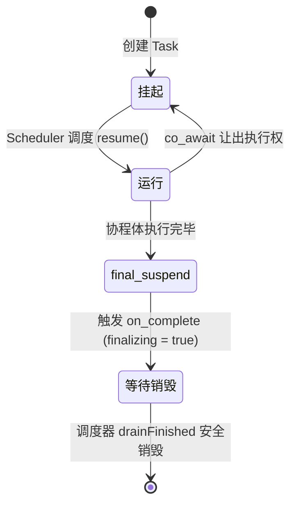

# Task<T> - 基于 C++20 的高性能对称协程

本项目实现了一个支持 `co_await` 的无栈协程类型 `Task<T>`（支持 `T` 与 `void`），专为高并发网络服务设计。不同于常见的教学级单线程协程 Demo，本模块重点解决了**多线程调度下协程帧（Coroutine Frame）的生命周期与悬垂引用问题**。

## ✨ 核心架构设计

### 1. 类型擦除与所有权提升（Type Erasure & Ownership Lift）
`Task<T>` 本身是一个轻量级的移动语义对象。当任务被提交给 `Scheduler` 时，通过 `TaskModel<T>`（继承自 `TaskBase`），将具体的协程句柄提升为 `std::shared_ptr<TaskBase>`。
- **解决的问题**：避免因为用户栈帧销毁，导致协程帧被意外连坐销毁。

### 2. 延迟销毁与安全转移（Deferred Destruction & Safe Handoff）
在 `final_suspend` 阶段，协程通过预先注册的 `on_complete` 回调，将自身的 `shared_ptr` 从 `m_runningTasks`（运行中列表）转移到 `m_finishedTasks`（已完成列表）。
- **设计精妙点**：转移过程严格遵循“先 `push` 到 finished 列表，后 `remove` 从 running 列表”，这一操作顺序保证了在极端多线程竞态下，协程对象的引用计数永远不会瞬间归零，彻底杜绝了并发导致的空悬指针（UAF）。

### 3. `finalizing` 原子免死金牌（Atomic UAF Prevention）
由于 C++20 协程的机制，在进入 `final_suspend` 后，协程依然在执行内部逻辑（例如调用完成回调）。如果此时外部调度器因为引用计数归零而执行 `destroy()`，会发生“摧毁正在执行自身的函数”的致命 UAF。
- **解决方案**：在 `promise_type` 中引入 `std::atomic<bool> finalizing`。进入 `final_suspend` 时置为 `true`，完全退出前置为 `false`。调度器的清理逻辑（`drainFinished`）在销毁协程前必须检查此标志位，实现安全的延迟回收。

## 🛠️ 生命周期状态图

